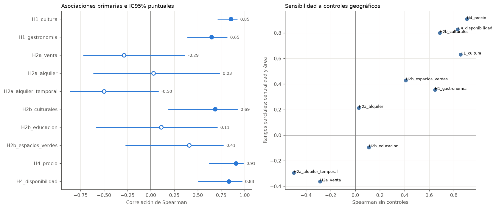
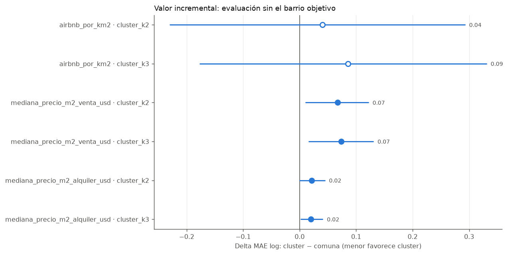

# Análisis inmobiliario y habitacional en la Ciudad de Buenos Aires

| Ariel Rakowsczyk        | 66828 |
|-------------------------|-------|
| Gaetano Murchio         | 66539 |
| Juan Cruz Moyano        | 65880 |
| Miranda Contieri Quiles | 67125 |

Analítica Descriptiva

2Q 2026

> **Dashboard publicado:** [abrir el informe interactivo en Power BI](https://app.powerbi.com/view?r=eyJrIjoiOGQ5ODllNTItODU4MS00OTEyLWFhMWItNjQwMGRhMjExYWE4IiwidCI6ImExZjUwYTk3LTIxYzAtNDlhNy1hOWQ0LWYyNDRlYmI0MmRhNyIsImMiOjR9&pageName=e377f501cce641b0905d). El enlace fue verificado con acceso público y contiene seis páginas de navegación.

## Índice

- [0 Organización del repositorio](#0-organización-del-repositorio)
- [1 Caso de negocio](#1-caso-de-negocio)
- [2 Scraping y recolección](#2-scraping-y-recolección)
- [3 Evaluación y planteo de hipótesis](#3-evaluación-y-planteo-de-hipótesis)
- [4 Formulación final](#4-formulación-final)
- [5 Estado analítico actual](#5-estado-analítico-actual)
- [6 Fuentes bibliográficas](#6-fuentes-bibliográficas)
- [7 Respuesta a la devolución y rúbrica de PE3](#7-respuesta-a-la-devolución-y-rúbrica-de-pe3)
- [8 Dashboard y recorrido narrativo](#8-dashboard-y-recorrido-narrativo)
- [9 Trazabilidad entre hipótesis, notebooks y decisiones](#9-trazabilidad-entre-hipótesis-notebooks-y-decisiones)

# 0 Organización del repositorio

El repositorio sigue una estructura orientada a trazabilidad del proceso KDD: los datos crudos se conservan sin modificaciones, las transformaciones se documentan por separado y los datasets procesados se guardan como salidas reproducibles.

```text
.
├── data/
│   ├── raw/                 # datos crudos obtenidos por scraping o descarga
│   └── processed/           # datasets limpios o consolidados para analisis
├── docs/                    # documentacion tecnica y metodologica
├── Fuentes_de_enriquecimiento/
│   └── datasets_contextuales_caba.py
├── notebooks/               # notebooks de calidad, limpieza y EDA
├── scrappers/               # scripts de extraccion por fuente
├── src/                     # funciones reutilizables para notebooks
├── requirements.txt
└── README.md
```

Los archivos en `data/raw` no deben editarse manualmente. Cualquier limpieza, union, imputacion, filtrado o normalizacion debe generar una nueva salida en `data/processed`, manteniendo documentada la decision aplicada.

La documentacion general de los scrapers se encuentra en `docs/scrapers.md`. La extraccion de Airbnb, por su complejidad tecnica, cuenta ademas con una documentacion especifica en `docs/scraper_airbnb.md`.

## 0.1 Reproduccion del entorno

Para preparar el entorno de trabajo:

```bash
python -m venv .venv
source .venv/bin/activate
python -m pip install -r requirements.txt
```

En Windows, la activacion del entorno puede realizarse con:

```bash
.venv\Scripts\activate
```

La instalación debe ejecutarse desde la raíz del repositorio. `requirements.txt` instala
el proyecto en modo editable (`-e .`) y sus dependencias declaradas en
`pyproject.toml`. El paquete importable conserva el nombre `src`: es código local,
no una dependencia para buscar en PyPI. Los cambios en `src/` se reflejan sin
reinstalar; al modificar dependencias, repetir la instalación.

Para usar el mismo entorno en Jupyter o VS Code:

```bash
python -m ipykernel install --user --name tp-analitica --display-name "TP Analítica (.venv)"
python -m jupyter lab
```

Seleccionar **TP Analítica (.venv)** en el notebook y reiniciar el kernel si estaba
abierto durante la instalación. Comprobar desde `notebooks/`:

```bash
python -c "from src import config; print(config.REPO_ROOT)"
```

La instalación editable permite importar desde cualquier directorio; las rutas de
`src.config` apuntan al checkout donde se instaló el proyecto. Conservar allí los
datos versionados. Para validar la secuencia:

```bash
python -m src.run_notebooks_sequential
```

Los scripts principales aceptan `--help` para revisar parametros, rutas de salida y limites de ejecucion:

```bash
python scrappers/scraper_mercadolibre_ventas.py --help
python scrappers/scraper_meli_alquileres_ampliado.py --help
python scrappers/scraper_argenprop_inmuebles.py --help
python scrappers/scraper_zonaprop_inmuebles.py --help
```

## 0.2 Estado actual de avance

- Repositorio organizado con datos crudos, scripts de extracción, notebooks por etapa, funciones reutilizables y salidas procesadas versionadas.
- Fuentes principales relevadas: Mercado Libre, Airbnb, ZonaProp y ArgenProp. La base consolidada actual contiene **67.887 publicaciones**: 43.345 de venta, 10.452 de alquiler permanente y 14.090 de alquiler temporario.
- Se completó el perfilado inicial, limpieza, normalización de categorías, tratamiento de duplicados, diagnóstico de nulos, imputaciones determinísticas, flags de faltantes, análisis de outliers, consolidación, EDA inicial, integración de fuentes externas, feature engineering territorial y un primer notebook de contraste de hipótesis.
- La base enriquecida final disponible en `data/processed/df_publicaciones_enriquecidas_v1.csv` tiene **67.887 filas y 90 columnas**, con precios comparables en USD, barrio/comuna oficial, distancias a transporte y servicios, indicadores censales y variables contextuales por barrio.
- Los reportes intermedios se guardan en `data/processed/reports`, para que las decisiones metodológicas no dependan solamente de la lectura visual de los notebooks.
- A partir de la limpieza se separan explícitamente variables observadas, variables reconstruidas desde información disponible, imputaciones determinísticas, flags de calidad y variables derivadas. Esta separación evita que una cadena de transformaciones quede mezclada con el dato originalmente observado.

## 0.3 Flujo de notebooks

| Notebook | Propósito | Salidas principales |
|---|---|---|
| `01_perfilado_calidad_raw.ipynb` | Inventario de archivos, columnas, tipos, ejemplos, nulos, rangos y cardinalidad. | `inventario_raw.csv`, `perfil_calidad_raw.csv`, diccionario inicial. |
| `02_normalizacion_y_limpieza.ipynb` | Normalización de nombres, categorías, fechas, barrios, monedas, duplicados y consolidación inicial. | Datasets preprocesados por fuente y `df_publicaciones_consolidadas_v1.csv`. |
| `03_analisis_de_nulos_con_tests_hipotesis.ipynb` | Matrices de faltantes, nulos vs cuantitativas, nulos por labels, pruebas de asociación y decisiones de tratamiento. | Datasets con flags de nulos y reportes de decisiones. |
| `04_outliers.ipynb` | Detección de valores atípicos con IQR, percentiles, gráficos y análisis contextual. | Datasets con flags de outliers y reporte IQR. |
| `05_feature_engineering_y_eda_inicial.ipynb` | EDA previo a fuentes externas: composición, cobertura, precios, superficies, barrios y calidad remanente. | Reportes de EDA inicial. |
| `06_fuentes_externas.ipynb` | Carga, documentación e integración de fuentes externas; geocodificación y validación territorial. | Inventario de fuentes, ubicación de publicaciones, contexto urbano por barrio. |
| `07_feature_engineering.ipynb` | Normalización monetaria, precios comparables, distancias, conteos cercanos y KPIs por barrio/comuna. | `df_publicaciones_enriquecidas_v1.csv`, `kpis_barrio_v1.csv`, `kpis_comuna_v1.csv`. |
| `08_eda_con_fuentes_externas.ipynb` | EDA con fuentes externas y primera contrastación de H1-H4. | Correlaciones, modelos, cuadrantes y síntesis de hipótesis. |
| `09_cierre_eda_y_priorizacion_kpis.ipynb` | Jerarquización de KPIs y reglas transparentes de diagnóstico. | Soporte, señales y candidatos comunales. |
| `10_reduccion_dimensionalidad_perfiles.ipynb` | PCA y MCA de perfiles territoriales sin usar precios como variables activas. | Varianza, cargas, contribuciones y coordenadas. |
| `11_segmentacion_y_validacion.ipynb` | K-means y Ward con silueta, estabilidad y perfilado. | Etiquetas de cluster y validaciones internas. |
| `12_modelos_explicativos_precios.ipynb` | Modelos log-lineales separados para venta y alquiler. | Coeficientes, IC agrupados por barrio y comparación de especificaciones. |
| `13_correspondencia_operacion_perfiles_propiedades.ipynb` | Correspondencia entre operación y perfiles no supervisados de publicaciones. | PCA, K-means, AMI/ARI y permutación condicionada. |
| `14_mca_y_analisis_factorial.ipynb` | MCA de propiedades y análisis factorial barrial condicionado a adecuación. | Dimensiones categóricas, KMO, Bartlett, comunalidades y factores. |
| `15_modelo_data_warehouse_dashboard.ipynb` | Construcción reproducible del mart dimensional para Power BI. | Tablas, relaciones, esquema, medidas DAX y paquete de importación. |
| `16_validacion_transversal_y_sensibilidad.ipynb` | Auditoría transversal de inferencia, espacio, sensibilidad, factores, clusters y H3. | Matriz de evidencia, 22 tablas y 9 visuales de robustez. |

# 1 Caso de negocio

## 1.1 Introducción

El mercado inmobiliario de la Ciudad de Buenos Aires se caracteriza por ser remarcablemente activo, dinámico, e incierto. Durante el período de 2025, el alquiler de vivienda representó un 36% de los hogares totales del distrito, junto con un 52% de hogares propietarios, y el restante 12% compuesto por diversas situaciones precarias e informales (1). Esto implica que las condiciones macroeconómicas en cuanto a nivel de precios y desarrollo, así como las tendencias en demografía, crecimiento urbano, y turismo, pueden incidir en una amplia proporción de las unidades habitacionales porteñas.

La estructura del mercado debe interpretarse a la luz de distintas condiciones económicas y regulatorias. Por un lado, el crédito hipotecario tuvo históricamente una participación reducida, aunque mostró una recuperación durante 2024-2025. Incluso en ese contexto, una parte importante de las compraventas continúa realizándose sin financiamiento hipotecario. Esto restringe el acceso a la compra a los hogares que disponen de ahorro previo, ingresos suficientes o capital propio, y mantiene al alquiler como principal alternativa de acceso a la vivienda para una parte relevante de la población.

A estas condiciones se suma el contexto de inflación y dolarización que caracteriza al mercado inmobiliario argentino. La inflación reduce el poder adquisitivo de los ingresos y dificulta la planificación de decisiones de largo plazo, como la compra o el alquiler de una vivienda. Al mismo tiempo, el dólar estadounidense funciona habitualmente como unidad de referencia para valuar las propiedades en venta, mientras que los alquileres pueden publicarse tanto en pesos como en dólares. Esta coexistencia de monedas genera diferencias en la forma de fijar los precios y en la exposición de propietarios e inquilinos a las variaciones del tipo de cambio. En particular, la evolución del tipo de cambio puede modificar el precio relativo de las propiedades y las condiciones de acceso a la vivienda, aunque sus efectos dependen de la moneda en la que se expresan los ingresos, los ahorros y las obligaciones contractuales de cada hogar.

Estas características también condicionan la demanda y la comparabilidad de los precios publicados. La incertidumbre inflacionaria y cambiaria puede incentivar a ciertos compradores a adelantar o postergar decisiones de adquisición, mientras que la evolución del tipo de cambio puede alterar la capacidad de compra de los hogares según sus ingresos y ahorros estén denominados en pesos o en dólares. Asimismo, comparar precios expresados en distintas monedas sin considerar el tipo de cambio y la fecha de publicación puede conducir a conclusiones distorsionadas. Por este motivo, el análisis deberá distinguir la moneda de publicación y contemplar que los precios observados corresponden a ofertas publicadas, no necesariamente a valores finales de operaciones concretadas. Además, las diferencias entre precios de venta, alquiler permanente y alquiler temporario no deben interpretarse como directamente comparables sin considerar las particularidades de cada modalidad.

Por otro lado, el marco regulatorio de los alquileres cambió sustancialmente, y puede haber modificado los incentivos de propietarios e inquilinos. La flexibilización contractual, luego de la derogación de la ley de alquileres en 2023, es uno de los motivos del aumento en la oferta publicada de departamentos en alquiler en AMBA, según un informe oficial de la Unidad de Evaluación de Impacto (2).

También existe legislación específica sobre el alquiler temporario. La Ley 6.255 de la Ciudad establece un Registro de Propiedades de Alquileres Temporarios Turísticos y obligaciones para quienes ofrecen este tipo de alojamiento. Este marco puede modificar los costos y los incentivos de los propietarios al elegir entre alquiler permanente y temporario. Sin embargo, dado que el trabajo utiliza un corte transversal, no se atribuirán directamente a la regulación las diferencias observadas entre modalidades.

Todas estas medidas de contexto económico muestran que el mismo patrón observado puede tener distintas explicaciones y, por lo tanto, distintas respuestas de política pública.

Comprender el impacto de estos factores urbanos en el mercado resulta importante para la gestión del espacio y servicios públicos, así como la del desarrollo inmobiliario privado. La Ciudad cuenta con 1,6 millones de viviendas, y su distribución y destino presentan una variedad especialmente rica en detalles e incertidumbre, siendo sujeto de un análisis multidimensional (3). La variedad de operaciones - compra, alquiler convencional, y alquiler temporal - produce una tensión económica y urbana, en cuanto al uso del recurso limitado de la vivienda, el espacio, y los servicios públicos. Así, se plantea la necesidad de explorar tendencias en este mercado que aclaren su funcionamiento, de manera unificada y multivariada.

A lo largo de este análisis, se recopilarán fuentes de publicaciones para venta y alquiler de viviendas de diferentes portales web, con sus atributos principales. Se intentará contrastar los diferentes factores urbanos con tendencias no solo a nivel precio, sino también en cuanto a tipo de operación solicitada, competitividad, y diseño habitacional. Se busca esclarecer el funcionamiento del mercado inmobiliario y producir insights accionables para el trabajo de reguladores y organismos públicos dedicados al desarrollo urbano, considerando tanto los factores económicos y urbanos que condicionan la oferta y la demanda como las limitaciones para comparar precios publicados en distintas monedas y modalidades de operación, con el objetivo de ponderar los beneficios económicos y sociales.

En particular, el Instituto de Vivienda de la Ciudad es el encargado de realizar análisis de disponibilidad, calidad, distribución, y tendencias a nivel hogares en Buenos Aires, así como elevar recomendaciones y desarrollar políticas de viviendas para el ejecutivo, en conjunto con áreas como Turismo y Planeamiento Urbano. Este organismo tiene la responsabilidad de detectar potenciales desequilibrios en el tejido urbano, y tiene a su disposición datos poblacionales y de la administración pública. Para el desarrollo del trabajo, nos ubicamos en el rol de esta institución, cuya tarea requiere **identificar en qué zonas la composición de la oferta inmobiliaria presenta posibles desequilibrios respecto de las necesidades habitacionales, las características demográficas y la disponibilidad de servicios urbanos.**

Al tratarse de un organismo estatal, se tiene como principal objetivo el beneficio social en su conjunto, ponderando equilibrio urbano, desarrollo, y acceso a vivienda, no exclusivamente la rentabilidad económica.

## 1.2 Definición operativa del problema

En este trabajo se denominará **desajuste territorial de la oferta habitacional** a una diferencia observable entre la composición de las publicaciones residenciales de una zona y una o más de las siguientes dimensiones: la estructura demográfica y habitacional de su población, la disponibilidad relativa de alquiler permanente, la concentración de alquiler temporario y el acceso a transporte y servicios urbanos.

El concepto no supone que las publicaciones representen la totalidad del stock de viviendas ni permite afirmar, por sí solo, la existencia de déficit habitacional, demanda insatisfecha, desplazamiento de residentes o sustitución de alquiler permanente por temporario. Las publicaciones se utilizarán como evidencia de la **oferta publicada** durante el período relevado. En consecuencia, los resultados permitirán detectar asociaciones, brechas y zonas que ameriten análisis o intervención prioritaria, pero no demostrar relaciones causales.

El desajuste se analizará inicialmente mediante dimensiones separadas, sin combinarlas de antemano en un único índice:

- **Adecuación tipológica:** relación entre la composición de los hogares y la participación de las distintas tipologías ofrecidas.
- **Disponibilidad residencial publicada:** cantidad de publicaciones de alquiler permanente en relación con la población, los hogares o el stock de viviendas de la zona, según la granularidad disponible.
- **Presión potencial del alquiler temporario:** densidad y participación de alojamientos temporarios completos respecto del stock habitacional y de la oferta residencial publicada.
- **Accesibilidad urbana:** disponibilidad o proximidad de transporte y servicios relevantes para las viviendas y la población de cada zona.

## 1.3 Decisiones públicas que busca informar

El análisis se concentrará en producir evidencia para tres decisiones del Instituto de Vivienda de la Ciudad:

1. **Priorizar zonas para ampliar o fortalecer la oferta de alquiler permanente.** Se identificarán áreas con baja disponibilidad residencial publicada o con una composición de tipologías poco alineada con el perfil de sus hogares.
2. **Priorizar zonas para monitorear la concentración del alquiler temporario.** Se señalarán barrios donde la densidad de alojamientos temporarios completos coincida con una baja disponibilidad relativa de alquiler permanente o con precios residenciales elevados. Esta coincidencia se interpretará como una señal para profundizar el diagnóstico, no como evidencia automática de desplazamiento.
3. **Priorizar intervenciones habitacionales o de accesibilidad urbana.** Se buscarán zonas en las que los desajustes de oferta coincidan con menor acceso a transporte o servicios, distinguiendo si la respuesta pertinente corresponde a vivienda, infraestructura, regulación, fiscalización o producción de información adicional.

Una zona será considerada prioritaria cuando combine una brecha de magnitud relevante, una cantidad suficiente de población potencialmente afectada y evidencia basada en un número mínimo de observaciones. Los umbrales definitivos se establecerán después del EDA, para evitar fijar reglas incompatibles con la distribución y calidad real de los datos.

## 1.4 Objetivos generales

- Medir la distribución territorial de las tres modalidades de operación.

- Comparar precios y características de los inmuebles entre barrios y modalidades.

- Analizar la relación entre el perfil demográfico de cada zona y su composición inmobiliaria.

- Evaluar si la disponibilidad y proximidad de servicios urbanos se relacionan con los precios y la concentración de la oferta.

- Construir indicadores sintéticos de accesibilidad, presión turística y disponibilidad habitacional.

- Segmentar barrios o micromercados según sus características demográficas, urbanas e inmobiliarias.

- Identificar zonas prioritarias para políticas de vivienda, infraestructura o regulación del alquiler temporal.

## 1.5 Preguntas de análisis

**Nivel descriptivo: características de la oferta publicada**

¿Cómo se distribuyen los tres tipos de operaciones en los diferentes barrios y comunas?

¿Qué precios, tipologías, u otras características predominan en cada operación?

¿Cómo se distribuyen los servicios urbanos, el transporte, los atractivos turísticos y las principales características demográficas?

**Nivel diagnóstico: explicación de patrones observados**

¿Cómo se relacionan la composición demográfica, la centralidad, los servicios públicos y otros atributos urbanos con la distribución territorial de las operaciones?

¿En qué medida la composición demográfica se relaciona con las tipologías residenciales ofrecidas en cada zona?

¿Las brechas territoriales de precio y composición de la oferta se mantienen al comparar propiedades y zonas semejantes?

**Nivel predictivo: estimaciones en función de las variables**

¿Cómo puede estimarse el precio publicado de un inmueble dentro de cada modalidad a partir de sus características, modalidad de operación, ubicación y entorno urbano?

¿Qué distribución de operaciones puede estimarse en una zona según sus características actuales demográficas, turísticas y de accesibilidad?

**Nivel prescriptivo: insights orientados a decisiones**

¿Qué zonas deberían priorizarse para fortalecer la oferta de alquiler permanente, monitorear la concentración del alquiler temporario o mejorar la accesibilidad urbana?

¿Qué indicadores debería monitorear el Instituto de Vivienda para detectar posibles desequilibrios entre alquiler temporal, alquiler permanente y necesidades habitacionales?

¿Qué alternativa de intervención resulta más adecuada para cada tipo de desajuste, considerando la magnitud de la brecha, la población potencialmente afectada, la calidad de la evidencia y las competencias del organismo?

## 1.6 Frontera operativa

El análisis comprende publicaciones de inmuebles residenciales ubicados dentro de la Ciudad Autónoma de Buenos Aires, obtenidas de Mercado Libre, ZonaProp, ArgenProp y Airbnb durante la etapa de extracción realizada entre agosto y septiembre de 2026. Se adopta un diseño de corte transversal: el objetivo es caracterizar la oferta disponible en el momento del relevamiento y no estudiar su evolución histórica.

La unidad de análisis será la publicación inmobiliaria activa en cada portal y fecha de consulta. Los registros representan oferta publicada y no necesariamente viviendas únicas, operaciones concretadas ni oferta efectiva de inmuebles. Se analizarán tres modalidades de operación: venta, alquiler permanente y alquiler temporal. Para favorecer su comparabilidad, se incluirán únicamente inmuebles destinados a uso habitacional, principalmente departamentos, casas y PH. Se excluirán cocheras, oficinas, locales comerciales, terrenos y otras propiedades sin destino residencial. En Airbnb, el análisis comparativo utilizará exclusivamente alojamientos completos, dejando fuera habitaciones privadas, habitaciones compartidas y establecimientos hoteleros.

El alcance geográfico será la totalidad de CABA. El barrio se utilizará como nivel principal para describir precios, tipologías, servicios y composición de la oferta cuando la localización lo permita. La comuna será empleada como unidad complementaria y como nivel común de integración con aquellas fuentes demográficas que no posean información desagregada por barrio.

En Airbnb, los precios corresponden a consultas realizadas para dos huéspedes y con fecha de inicio el 20 de octubre de 2026, utilizando ventanas comparables de cinco y treinta noches. Estos valores representan precios ofrecidos para condiciones de búsqueda específicas y no precios promedio históricos del alojamiento.

El estudio analizará precios publicados, características de los inmuebles, composición territorial de la oferta y su relación con variables demográficas y de entorno urbano. No se estimarán rentabilidades financieras ni se estudiarán operaciones inmobiliarias efectivamente realizadas. Debido a su naturaleza observacional y transversal, los resultados permitirán identificar asociaciones, brechas y patrones territoriales, pero no establecer por sí solos relaciones causales.

## 1.7 Hoja de ruta

| **Tarea**                                  | **Semana**       | **Descripción**                                                                                                                                                       |
|--------------------------------------------|------------------|-----------------------------------------------------------------------------------------------------------------------------------------------------------------------|
| Definición del problema                    | 10 de agosto     | Planteo de posibles casos de negocio, preguntas de interés, limitaciones, factor diferencial.                                                                         |
| Planteo de objetivos                       | 17 de agosto     | Profundidad del análisis, definición del interlocutor, investigación de disponibilidad de fuentes primarias y secundarias, prueba de concepto.                        |
| Extracción de datos                        | 24 de agosto     | Scrapeo y consultas de APIs, ejecución de la extracción, definición de columnas clave.                                                                                |
| Reformulación iterativa                    | 31 de agosto     | Desarrollo de los objetivos según la data disponible, reformulación y extracción iterativa y delimitación del alcance.                                                |
| Presentación y primera entrega             | 7 de septiembre  | Preparación del informe, organización del repositorio, importación de la data a Python.                                                                               |
| Integración de datos y limpieza            | 14 de septiembre | Análisis de compatibilidad de las fuentes de información, tratamiento de valores faltantes y atípicos.                                                                |
| Enriquecimiento y feature engineering      | 21 de septiembre | Incorporación de las fuentes externas, ingeniería de atributos, definición de nuevas columnas.                                                                        |
| EDA                                        | 28 de septiembre | Análisis de escalas y distribuciones, normalización, análisis univariado y bivariado.                                                                                 |
| Análisis visual y segunda entrega          | 5 de octubre     | Preparación del informe, confección de visuales, narración de insights preliminares, comunicación de lo hallado.                                                      |
| Tests de hipótesis                         | 12 de octubre    | Análisis estadístico de las hipótesis planteadas, refutación o validación de hipótesis, confianza de los estimadores.                                                 |
| Fusión espacial y enriquecimiento complejo | 19 de octubre    | Integración de fuentes y variables geográficas, cálculo de distancias y densidades de servicios.                                                                      |
| Reducción de dimensionalidad               | 26 de octubre    | Empleo de PCA y MCA para hallar componentes de mayor impacto, creación de índices multivariados.                                                                      |
| Algoritmos predictivos y tercera entrega   | 2 de noviembre   | Análisis de similitud y clustering, y otros algoritmos predictivos a fin de entender pesos de variables.                                                              |
| Definición de la narrativa final           | 9 de noviembre   | Compilación de todos los hallazgos, desarrollo de tablero interactivo.                                                                                                |
| Presentación final                         | 16 de noviembre  | Exposición final, insights y recomendaciones principales, ponderación de fortalezas y debilidades, alcance y dificultades del análisis, y cierre del caso de negocio. |

# 2 Scraping y recolección 

El proceso de recolección de datos comenzó con el scraper proporcionado por la cátedra, adaptado y/o tomado de punto de partida para extraer registros de ArgenProp, ZonaProp, Airbnb, y Mercado Libre. En el caso de este último se hace uso de la API del sitio para acceder a la información.

En el caso particular de Airbnb, el scraper de la cátedra obtuvo 29 registros únicos tras recorrer 55 páginas. El motivo es que el sitio corta toda consulta en 15 páginas de 18 resultados (unos 270 anuncios) y a partir de ahí devuelve resultados repetidos. Al revisar esto se encontró además que Airbnb incluye el JSON completo de los resultados dentro del HTML de la página, por lo que no hace falta renderizarla con un navegador: alcanza con una petición simple. Sobre esa base se desarrolló un scraper propio.

Para superar el tope de resultados se dividió el territorio en celdas geográficas. Se consulta una celda; si alcanza el máximo de páginas, se la parte en cuatro y se repite el procedimiento sobre cada parte, hasta que cada celda entra completa. El criterio no es una estimación propia: el sitio informa cuántas páginas tiene realmente cada consulta. La ejecución final recorrió 147 celdas y obtuvo 11.276 anuncios, con mayor subdivisión en el corredor Palermo–Recoleta–Centro. La extracción se hizo en dos etapas: primero el censo de anuncios, y luego la ficha completa de cada uno, que aporta capacidad, calificaciones desagregadas, datos del anfitrión, reglas de la vivienda y el listado de comodidades. Entre pedidos se dejó un intervalo de 1,2 a 2 segundos, y no se registraron bloqueos.

Como Airbnb dejó de informar el barrio, éste se dedujo de las coordenadas contra el GeoJSON oficial de los 48 barrios, la misma fuente listada en el apartado 3.2. La asignación cubre el 99,2% de los registros.

Una particularidad de esta fuente es que el precio no es un atributo fijo del inmueble, sino que depende de las fechas y de la cantidad de huéspedes consultadas. Por eso se relevaron dos series con ventanas fijas, ambas para dos huéspedes y con inicio el 20 de octubre de 2026: una de 5 noches y otra de 30. Los precios son comparables dentro de cada serie. Comparando entre ellas se observa un descuento mediano del 22,3% por estadía prolongada, y se identifican 1.500 anuncios que no aceptan estadías cortas. Ese segmento queda documentado como una señal de interés para comparar alquiler temporario y permanente, aunque la contrastación central del proyecto se realiza luego con KPIs territoriales en los notebooks 07 y 08. Cabe aclarar que Airbnb no publica superficie en metros cuadrados, dirección exacta ni expensas. Se generan tres archivos por serie porque responden a usos distintos. El normalizado es el que entra al análisis comparativo entre portales: está filtrado a vivienda entera y usa el vocabulario común. El listings conserva todo sin decisiones tomadas de antemano, para poder revisar los criterios de filtrado. El amenities existe porque pasar 3.362 comodidades a columnas produciría un archivo de 3.400 columnas, en su mayoría con un único anuncio: el formato ancho conserva sólo las 168 presentes en al menos el 1% de los casos, y el largo preserva el resto.

En el caso de ArgenProp y ZonaProp, solo se consiguieron 162 y 980 registros, por encontrar bloqueos en la IP al pedir tanta información en poco tiempo. Aparte, como se usó `--listings-only`, hubo reducción en el detalle de la información. De esta manera, en el CSV creado hay muchos datos faltantes que podrían ser útiles para el análisis: datos de ubicación precisos, como latitud, longitud y barrio o datos propios de las viviendas, como si poseen balcón, terraza, ascensor, calefacción, entre muchos otros. En etapas posteriores se recuperó parte de la dimensión territorial con normalización de barrio y geocodificación cuando había dirección suficiente; ZonaProp se conserva principalmente como fuente de contraste porque no trae dirección completa para calcular distancias a servicios.

Cabe señalar que, si bien el alcance geográfico definido comprende la totalidad de CABA, la cobertura efectiva lograda no es homogénea entre fuentes. Mercado Libre y Airbnb aportan volúmenes sustanciales (44.013, 11.479 y 6.190 registros para venta, alquiler y alquiler temporal respectivamente en el primer caso, y 10.326 en el segundo), mientras que ArgenProp y ZonaProp quedaron acotados a 162 y 980 registros por los bloqueos de IP descriptos anteriormente. Esta asimetría implica que la representatividad barrio a barrio de estas dos últimas fuentes es limitada, y que ciertos barrios o segmentos del mercado podrían estar sub-representados en relación con su peso real en la oferta. Para mitigar este desequilibrio, el análisis territorial de mayor granularidad se apoyará principalmente en Mercado Libre y Airbnb, reservando ArgenProp y ZonaProp como fuentes complementarias y de contraste antes que como base primaria para comparaciones finas entre barrios. De ser posible, se evaluará ampliar la recolección de estas dos fuentes en etapas posteriores, espaciando las solicitudes para reducir el riesgo de bloqueo.

Para cada sitio, se ejecuta el scraper y se producen uno o más archivos csv con los registros de las publicaciones. En la etapa raw, estas bases nacen independientes: el proceso de scrapeo se realizó de manera aislada y adaptada a la estructura de cada portal, presentando los archivos finales distintos grados de compatibilidad. La limpieza posterior trabaja justamente sobre esa diferencia de formatos para construir columnas canónicas, separar faltantes estructurales de faltantes propios de cada publicación y consolidar una base comparable.

# 3 Evaluación y planteo de hipótesis

## 3.1 Estado actual de la data recolectada

| **Archivo .csv**                | **Filas** | **Columnas** | **Fuente** | **Operación** | **Observaciones**                                                                         |
|---------------------------------|-----------|--------------|------------|---------------|-------------------------------------------------------------------------------------------|
| airbnb_caba_normalizado         | 10.326    | 59           | Airbnb     | Alq. temp     | Ventana de 5 noches. Vivienda entera, vocabulario homologado al de los demás portales.    |
| airbnb_caba_normalizado_mensual | 9.596     | 60           | Airbnb     | Alq. temp     | Ventana de 30 noches, misma fecha de inicio                                               |
| airbnb_caba_listings            | 11.276    | 287          | Airbnb     | Alq. temp     | Base completa: incluye habitaciones, alojamiento hotelero y columnas de comodidades seleccionadas |
| airbnb_caba_listings_mensual    | 10.369    | 288          | Airbnb     | Alq. temp     | Ídem, ventana mensual                                                                     |
| airbnb_caba_amenities           | 416.395   | 6            | Airbnb     | Alq. temp     | Formato largo: un registro por anuncio y comodidad                                        |
| airbnb_caba_amenities_mensual   | 466.706   | 6            | Airbnb     | Alq. temp     | Ídem, ventana mensual                                                                     |
| meli_alq_temp_x                 | 6190      | 61           | MeLi       | Alq. temp     | Compatibilidad de columnas con otros archivos de MeLi                                     |
| meli_alq_x                      | 11479     | 61           | MeLi       | Alquiler      | Compatibilidad de columnas con otros archivos de MeLi                                     |
| meli_vtas_x                     | 44013     | 61           | MeLi       | Vtas.         | Compatibilidad de columnas con otros archivos de MeLi                                     |
| propiedades_zonaprop            | 980       | 96           | ZonaProp   | Vtas. y Alqs. | Compatibilidad de columnas con ArgenProp. Mismo dataset para ventas y alquileres.         |
| propiedades_argenprop           | 162       | 96           | ArgenProp  | Vtas. y Alqs. | Compatibilidad de columnas con ZonaProp. Mismo dataset para ventas y alquileres.          |

Luego del perfilado inicial, estas bases fueron normalizadas y consolidadas en notebooks separados. El análisis de calidad mostró que los faltantes no son homogéneos: una parte corresponde a ausencias reales de cada publicación y otra a diferencias estructurales entre portales. Por eso el tratamiento se realizó por fuente y por operación antes de consolidar.

## 3.2 Fuentes de enriquecimiento

A continuación se listan las potenciales fuentes de enriquecimiento de los datos, con variables demográficas, urbanísticas, económicas, o de otro modo útiles para el análisis.

|                                                                                                                                              | **Fuente** | **Observaciones**                                                      |
|----------------------------------------------------------------------------------------------------------------------------------------------|------------|------------------------------------------------------------------------|
| [<u>Listado de gastronómicos turísticos</u>](https://data.buenosaires.gob.ar/dataset/oferta-establecimientos-gastronomicos)                  | GCBA       | Establecimientos gastronómicos designados como de interés turístico    |
| [<u>Listado de establecimientos educativos</u>](https://data.buenosaires.gob.ar/dataset/establecimientos-educativos)                         | GCBA       | Escuelas y centros de educación públicos y privados                    |
| [<u>Listado de hospitales</u>](https://data.buenosaires.gob.ar/dataset/hospitales)                                                           | GCBA       | Centros de salud públicos y privados                                   |
| [<u>Listado de espacios culturales</u>](https://data.buenosaires.gob.ar/dataset/espacios-culturales)                                         | GCBA       | Espacios de cultura públicos y privados.                               |
| [<u>Listado de espacios verdes</u>](https://data.buenosaires.gob.ar/dataset/espacios-verdes)                                                 | GCBA       | Plazas, parques, y otros designados como espacio verde.                |
| [<u>Listado de estaciones de Subte</u>](https://data.buenosaires.gob.ar/dataset/subte-estaciones)                                            | GCBA       | Ubicación de las 90 estaciones                                         |
| [<u>Listado de corredores de MetroBus</u>](https://data.buenosaires.gob.ar/dataset/metrobus/resource/Juqdkmgo-1431222-resource)              | GCBA       | Corredores y estaciones del sistema de carriles para colectivos        |
| [<u>Listado de estaciones de ferrocarril</u>](https://data.buenosaires.gob.ar/dataset/estaciones-ferrocarril)                                | GCBA       | Estaciones de Trenes Argentinos.                                       |
| [<u>Censo poblacional 2022</u>](https://censo.gob.ar/index.php/datos_definitivos_caba/)                               | INDEC      | Permite contar la cantidad de hogares por comuna.                      |
| [<u>USIG - Normalizador de Direcciones (API)</u>](https://servicios.usig.buenosaires.gob.ar/normalizar/)                                     | USIG       | Permite encontrar la latitud y longitud de una dirección.              |
| [<u>GeoJson de Barrios</u>](https://cdn.buenosaires.gob.ar/datosabiertos/datasets/innovacion-transformacion-digital/barrios/barrios.geojson) | GCBA       | Permite conocer el barrio correspondiente a una latitud y longitud.    |

Estas fuentes agregan información sobre el entorno urbano y permiten definir columnas relativas a presencia, proximidad y densidad de servicios por geografía. También se incluyen indicadores sociales y habitacionales del Censo 2022, para enriquecer los perfiles geográficos hasta la granularidad disponible. Finalmente se incluyen fuentes para compatibilizar ubicaciones mediante coordenadas, direcciones y polígonos oficiales.

Durante la integración se descartaron bibliotecas y pasajeros de subte como fuentes centrales. Las bibliotecas quedan parcialmente contenidas dentro de espacios culturales y el uso de subte no se incorpora por estación comparable, porque la fuente disponible se presenta por línea/año y no por punto territorial directamente asociable a cada publicación. Esta decisión evita sumar variables atractivas en apariencia pero débiles para las hipótesis del trabajo.

# 4 Formulación final

En base a la información y formatos disponibles, se decide finalmente como objetivo de la investigación el desarrollo de un análisis particular y comparativo de las diferentes operaciones (venta, alquiler permanente, y temporal), en dimensiones geográficas, económicas, y demográficas. Quedan excluidos del análisis componentes relativos a la rentabilidad financiera del desarrollo, alquiler, compra-venta, refacción, mejora de inmuebles, o cualquier otra actividad inmobiliaria como inversión.

## 4.1 Métricas y KPIs preliminares

Se definen indicadores como puntapié inicial para el estudio tanto de mercados individuales como para comparaciones entre tipos de operaciones.

- **Precio por m² en el barrio b** = Promedio, para las publicaciones del barrio b, de (precio de la publicación i / superficie en m² de la publicación i). Se calculará para venta y alquiler permanente.[^1]

- **Precio por ambiente en el barrio b** = Promedio, para las publicaciones comparables del barrio b, de (precio mensual o de venta de la publicación i / cantidad de ambientes de la publicación i). Se utiliza para comparar alquiler temporal y permanente porque Airbnb no informa superficie y Mercado Libre informa dormitorios con muy baja cobertura.[^2]

- **Medidas de tendencia central y dispersión del precio por m²** = Se calcularán medidas como mediana, promedio, percentiles y dispersión de los precios por m², diferenciando entre venta y alquiler permanente.

- **Participación de la operación i en el barrio b** = Publicaciones de la operación i en el barrio b / total de publicaciones en el barrio b.

- **Intensidad de oferta publicada en la comuna c** = Publicaciones de la operación i en la comuna c / población total de la comuna c × 1.000. Este indicador representa la cantidad de publicaciones por cada 1.000 habitantes y no debe interpretarse como cantidad de viviendas disponibles por habitante.[^3]

- **Densidad de servicios s en el barrio b** = Cantidad de establecimientos o puntos de servicio s en el barrio b / superficie del barrio b en km².

- **Prima asociada a un amenity a** = (Precio promedio de las publicaciones que mencionan el amenity a / Precio promedio de las publicaciones que no lo mencionan) − 1. El resultado se expresará como porcentaje y permitirá estimar la diferencia relativa de precio asociada a la presencia del atributo.[^4]

- **Brecha entre alquiler temporal y permanente en el barrio b** = (Precio mediano mensual por ambiente del alquiler temporal en el barrio b / precio mediano mensual por ambiente del alquiler permanente en el barrio b) − 1. El resultado permite observar la diferencia relativa entre ambas modalidades, separando Airbnb y Mercado Libre temporario cuando sus precios no son comparables.[^5]

- **Oferta de ambientes n en el barrio b** = Cantidad de publicaciones de n ambientes en el barrio b / total de publicaciones en el barrio b.

- **Brecha norte-sur del indicador i** = (Valor del indicador i en los barrios del norte − valor del indicador i en los barrios del sur) / valor del indicador i en los barrios del sur.

Estos indicadores se implementan y refinan en los notebooks 07 y 08, de acuerdo con la cobertura real de cada fuente, la unidad geográfica disponible y las necesidades de cada hipótesis.

## 4.2 Hipótesis a contrastar

Las hipótesis se formulan como relaciones contrastables entre variables observables. Se distinguirán las hipótesis centrales, directamente vinculadas con las decisiones públicas priorizadas, de los análisis complementarios. Debido al carácter observacional y transversal de los datos, su contrastación permitirá identificar asociaciones, pero no atribuir causalidad.

| | Formulación | Variable explicativa principal | Variable de resultado | Comparación y controles previstos |
|---|---|---|---|---|
| **H1 — Concentración turística** | Los barrios con mayor atractivo turístico y cultural presentan una mayor densidad de alojamientos temporarios completos. | Densidad de espacios culturales, gastronómicos, turísticos y verdes. | Alojamientos temporarios completos por 1.000 viviendas y participación del alquiler temporario en la oferta publicada. | Control por centralidad, población, stock habitacional, superficie del barrio y accesibilidad al transporte. |
| **H2a — Adecuación demográfica** | Los barrios o comunas con mayor proporción de hogares unipersonales presentan una mayor participación de monoambientes y unidades de uno o dos ambientes en la oferta publicada. | Proporción de hogares unipersonales. | Participación de unidades pequeñas dentro de la oferta residencial. | Separación por modalidad y fuente; control por centralidad, densidad poblacional y composición del stock habitacional cuando esté disponible. |
| **H2b — Servicios y concentración de oferta** | Las zonas con mayor disponibilidad de servicios urbanos presentan una mayor intensidad de oferta inmobiliaria publicada. | Densidad o proximidad de establecimientos educativos, sanitarios, culturales y espacios verdes. | Publicaciones por 1.000 habitantes, hogares o viviendas. | Análisis separado por tipo de servicio y modalidad; control por población, stock habitacional, superficie y centralidad. |
| **H3 — Transporte y precio** | Entre propiedades comparables, una menor distancia al transporte público masivo se asocia con un mayor precio publicado. | Distancia a estaciones de subte, tren y MetroBus, diferenciadas por medio. | Precio por m² para venta y alquiler permanente; precio por ambiente cuando se requiere una métrica transversal. | Comparación dentro de zonas y tipologías semejantes; control por barrio, superficie, ambientes, tipo de propiedad, fuente y amenities disponibles. |
| **H4 — Presión potencial del alquiler temporario** | Los barrios con mayor densidad de alojamientos temporarios completos presentan una menor disponibilidad relativa de alquiler permanente y mayores precios residenciales publicados. | Alojamientos temporarios completos por 1.000 viviendas. | Alquileres permanentes publicados por 1.000 viviendas y nivel de precios residenciales. | Control por centralidad, atractivo turístico, población, stock habitacional, tipología y accesibilidad. No se interpretará la asociación como evidencia de desplazamiento o sustitución causal. |

### Criterios de contrastación

- Se definirá para cada hipótesis una unidad geográfica común —barrio o comuna— según la menor granularidad compatible entre las fuentes utilizadas.
- Los conteos de publicaciones se normalizarán por población, hogares, viviendas o superficie, evitando comparar valores absolutos entre zonas de distinto tamaño.
- Se exigirá un mínimo de observaciones por zona y modalidad antes de calcular indicadores o realizar comparaciones; el umbral se fijará durante el EDA.
- Las relaciones bivariadas se utilizarán como exploración inicial. Cuando sea posible, se aplicarán modelos multivariados o comparaciones estratificadas para controlar diferencias de centralidad, tipología y composición territorial.
- Se reportarán magnitud del efecto, incertidumbre y sensibilidad a distintas definiciones, además del p-valor cuando corresponda.
- Si la granularidad, cobertura o calidad de una fuente no permite contrastar una hipótesis, esta se reformulará o se informará como limitación, en lugar de forzar la integración.

# 5 Estado analítico actual

Esta sección resume lo que ya fue ejecutado en los notebooks y deja documentadas las principales decisiones tomadas. El objetivo es que el lector pueda entender el recorrido sin abrir todos los archivos, y que luego pueda auditar cada afirmación en `data/processed` y `data/processed/reports`.

## 5.1 Base consolidada y cobertura

La base consolidada contiene **67.887 publicaciones** de cuatro fuentes:

| Fuente | Publicaciones |
|---|---:|
| Mercado Libre | 57.149 |
| Airbnb | 9.596 |
| ZonaProp | 980 |
| ArgenProp | 162 |

Por operación, la base queda compuesta por **43.345 ventas**, **10.452 alquileres permanentes** y **14.090 alquileres temporarios**. La asimetría entre fuentes es importante: Mercado Libre y Airbnb sostienen la mayor parte del análisis, mientras que ZonaProp y ArgenProp se usan como contraste y complemento por su menor cobertura.

La cobertura territorial final es alta: `barrio_oficial` y `comuna_oficial` están completos en el **99,7%** de los registros enriquecidos. Las coordenadas están disponibles en el **86,9%** de las publicaciones. Esta diferencia se explica principalmente por ZonaProp, que conserva barrio/comuna pero no trae dirección suficiente para geocodificar con USIG.

## 5.2 Limpieza, normalización y duplicados

Se mantuvo una lógica conservadora: no se reemplazaron valores centrales cuando no había evidencia suficiente, y se priorizó reconstruir variables derivables antes que imputarlas estadísticamente. Cuando una columna fue completada, se documenta si el valor surge de una regla determinística, una reconstrucción desde texto/rangos o un cálculo derivado. Esto es importante para que las variables no acumulen transformaciones heurísticas sin control.

Decisiones principales:

- Se normalizaron nombres de barrios, monedas, operaciones, fechas y columnas canónicas entre fuentes.
- `Las Cañitas` se trató como subzona de Palermo y se asignó a la comuna correspondiente.
- `localidad` se eliminó cuando solo indicaba CABA, porque no aporta variación dentro del alcance del trabajo.
- Se separaron ArgenProp y ZonaProp por tipo de operación antes de analizar nulos, ya que mezclar ventas y alquileres generaba faltantes estructurales difíciles de interpretar.
- Se completó `comuna` desde `barrio_norm` cuando había correspondencia oficial barrio-comuna. Esto imputó 164 comunas en MeLi alquiler, 148 en MeLi temporario, 544 en MeLi venta y 918 en ZonaProp; en ArgenProp no se imputó porque el campo de barrio no era confiable.
- No se eliminaron filas por faltantes críticos en esta etapa. Se crearon flags y se dejó la exclusión para KPIs específicos cuando falta la variable necesaria.

Duplicados:

- No se encontraron duplicados exactos en los raw.
- En Mercado Libre sí aparecieron duplicados por `item_id`: 1.602 en alquiler, 1.696 en alquiler temporario y 1.235 en venta. Se deduplicaron por identificador de publicación.
- En ArgenProp, ZonaProp y Airbnb no se detectaron duplicados por URL o `property_id`.
- Los duplicados inter-fuente no aparecieron con la regla aplicada. La ausencia de coincidencias se interpreta con cautela, porque las fuentes no comparten identificadores y algunas direcciones son incompletas.

## 5.3 Nulos y decisiones de tratamiento

El diagnóstico de nulos se hizo en dos momentos: primero sobre los datasets originales preprocesados, y luego después de ajustes derivados del propio análisis. Esto permite mostrar el camino de decisión: se observan los patrones, se corrigen problemas estructurales y recién después se decide qué tratar.

Criterios usados:

| Caso | Decisión |
|---|---|
| Columnas 100% vacías | Borrar, salvo que sean necesarias para mantener compatibilidad temporal del pipeline. |
| Columnas con muchos nulos y sin presencia útil en otros datasets | Borrar. |
| Columnas con muchos nulos pero reconstruibles desde texto, rangos o variables equivalentes | Mantener para reconstrucción. |
| Variables objetivo o críticas, como precio, moneda, barrio, superficie y ambientes | No imputar con medias/modas; reconstruir solo si hay evidencia. |
| Variables derivadas, como `precio_m2_ref` | Recalcular desde sus componentes válidos. |
| Variables categóricas con faltantes informativos, como inmobiliaria/seller | Mantener flag; usar `no_informado` solo para gráficos cuando corresponda. |

En expensas se decidió no reemplazar nulos por 0, porque "no informado" no significa "sin expensas". En cocheras, en cambio, se dejó una regla más operativa: puede imputarse 0 cuando el texto no identifica cochera, pero conservando la posibilidad de reconstrucción textual si la publicación la menciona.

## 5.4 Outliers

Los outliers se marcaron, pero no se eliminaron automáticamente. En real estate, los extremos pueden ser propiedades reales: unidades premium, superficies muy grandes, amenities de lujo, publicaciones temporarias con estadías particulares o errores de carga. Por eso se usaron flags antes que filtros destructivos.

El análisis detectó outliers por percentiles p01-p99 en todos los segmentos: 617 en MeLi alquiler, 268 en MeLi temporario, 2.635 en MeLi venta, 6 en ArgenProp venta, 14 en ArgenProp alquiler, 27 en ZonaProp venta, 33 en ZonaProp alquiler y 767 en Airbnb. Además, Airbnb mostró 1.650 valores inválidos en variables cuantitativas revisadas. Luego se detectaron outliers por método IQR y Mahalanobis robusto. Según estos tres criterios, se clasificaron los outliers en sin alerta, revisar, prioridad baja y prioridad alta. Estos registros no se borraron; quedan identificados con flags para decidir su uso según el KPI o análisis.

## 5.5 Fuentes externas e ingeniería de variables

El enriquecimiento territorial incorpora 12 fuentes o componentes:

| Componente | Uso principal |
|---|---|
| Censo 2022 por comuna | Denominadores de población, viviendas, hogares, hogares inquilinos y composición habitacional. |
| GeoJSON oficial de barrios | Asignación de barrio oficial, comuna y superficie. |
| USIG | Geocodificación de direcciones de portales sin coordenadas. |
| Dólar MEP diario | Normalización de precios ARS a USD según fecha de extracción. |
| Subte, tren y MetroBus | Distancias a transporte masivo y densidades por barrio. |
| Espacios verdes | Distancia y porcentaje de superficie verde por barrio. |
| Educación, hospitales, cultura y gastronomía turística | Conteos, densidades y servicios cercanos. |

Variables derivadas relevantes:

- `precio_venta_usd`, `precio_mensual_usd`, `precio_m2_usd` y `precio_por_ambiente_usd`.
- `barrio_oficial`, `comuna_oficial`, `lat`, `lon`, `metodo_geo` y `origen_barrio`.
- `dist_subte_m`, `dist_tren_m`, `dist_metrobus_m`, `dist_transporte_masivo_m` y `dist_espacio_verde_m`.
- `n_culturales_500m`, `n_gastronomia_500m` y `n_educacion_500m`.
- Densidades por km² de transporte, educación, hospitales, cultura, gastronomía y espacios verdes.
- KPIs por barrio y comuna: publicaciones por 1.000 habitantes/viviendas, Airbnb por km², brechas temporario-permanente y medianas de precio.

La cobertura de variables enriquecidas es desigual: precios por ambiente están disponibles en el **98,6%** de los registros, precio por m² en el **79,1%**, y distancias/servicios cercanos en el **86,9%**, atados a la disponibilidad de coordenadas.

## 5.6 Hallazgos descriptivos consolidados

Estos resultados describen la oferta publicada capturada; no representan el stock total de viviendas, contratos cerrados ni demanda efectiva.

- La oferta de venta domina el volumen total: 43.345 publicaciones frente a 10.452 alquileres permanentes y 14.090 temporarios.
- El alquiler temporario está mucho más concentrado territorialmente. Palermo reúne 3.222 anuncios de Airbnb, Recoleta 1.322 y San Nicolás 568.
- En términos de densidad, San Nicolás, Recoleta, Palermo y Monserrat aparecen entre los barrios con mayor presión temporaria por km².
- La comuna 14 concentra 3.222 Airbnb y tiene 21,37 Airbnb cada 1.000 viviendas, frente a 9,49 alquileres permanentes cada 1.000 viviendas.
- En precios publicados, las ventas se expresan casi siempre en USD, mientras que los alquileres combinan ARS y USD. Por eso la normalización monetaria con MEP es necesaria antes de comparar.
- El precio por m² y el precio por ambiente se usan de forma complementaria: Airbnb no tiene superficie, y Mercado Libre casi no informa dormitorios de manera comparable.

## 5.7 Contrastación final de hipótesis

La contrastación principal usa Spearman, intervalos bootstrap pareados y permutaciones bilaterales. La auditoría del notebook 16 agrega corrección por multiplicidad, controles de centralidad, sensibilidad leave-one-out y diagnóstico espacial. Para H3 se estiman modelos por publicación con errores agrupados por barrio y formas funcionales alternativas. `rho` es la correlación de Spearman; `q` es el p-valor ajustado por Benjamini-Hochberg.

| Hipótesis y formulación nula | Resultado principal | Robustez y lectura | Implicación para el Instituto |
|---|---|---|---|
| **H1.** H0: la densidad cultural/gastronómica no se asocia con Airbnb por km². H1: la asociación es positiva. | Cultura: `rho=0,85`, IC95% `[0,71; 0,92]`, `p_perm=0,0005`, 48 barrios. Gastronomía: `rho=0,65`, IC95% `[0,39; 0,81]`, `p_perm=0,0005`. | Con controles de centralidad, cultura conserva `rho_parcial=0,63`, `q=0,005`; gastronomía `rho_parcial=0,35`, `q=0,034`. Hay autocorrelación espacial y el residuo cultural también conserva estructura espacial, por lo que no se interpreta causalmente. **Evidencia consistente a favor de asociación territorial.** | Priorizar monitoreo en áreas con alta concentración temporaria y cultural, sin atribuir a los equipamientos culturales la causa de la concentración. |
| **H2a.** H0: el proxy de tamaño de hogar no se asocia con la oferta de unidades pequeñas. H1: hogares más pequeños se asocian con mayor participación de unidades chicas. | Venta `rho=-0,29`, alquiler `rho=0,03`, temporal `rho=-0,50`; todos los IC incluyen cero y las permutaciones no rechazan H0 al 5%. | El resultado no cambia al controlar centralidad. El tamaño medio del hogar no equivale a hogares unipersonales y solo hay 15 comunas. **Evidencia insuficiente; no se demuestra ausencia de relación.** | No usar este proxy como regla de adecuación habitacional. Requiere una fuente específica de hogares unipersonales y mejor granularidad. |
| **H2b.** H0: la disponibilidad de servicios no se asocia con la intensidad de alquiler publicado. H1: la asociación es positiva. | Cultura `rho=0,69`, IC95% `[0,19; 0,92]`, `p_perm=0,008`; educación `rho=0,11`, `p_perm=0,693`; verdes `rho=0,41`, `p_perm=0,130`. | Cultura se fortalece con control de centralidad (`rho_parcial=0,80`, `q=0,00875`); educación y verdes siguen sin evidencia concluyente. **Apoyo parcial y específico, no generalizable a todos los servicios.** | Separar tipos de servicio; no construir una única puntuación de “servicios” suponiendo efectos equivalentes. |
| **H3.** H0: condicional a atributos comparables, la distancia al transporte no se asocia con el precio por m². H1: mayor distancia se asocia con menor precio. | El modelo lineal encuentra el signo contrario: por 100 m adicionales, alquiler `+1,0%` y venta `+0,8%`, con IC agrupados que no incluyen cero. | Formas cuadrática y logarítmica conservan efectos positivos pequeños, pero RESET rechaza especificación correcta y hay heterocedasticidad, no normalidad e influencia. Por ejemplo, en alquiler el efecto cae de `+1,60%` a `+0,89%` entre los percentiles 25 y 75 de distancia. **La hipótesis direccional no recibe apoyo; el coeficiente no debe interpretarse causalmente.** | No usar distancia lineal al transporte como prima de precio ni como criterio aislado. Se requieren accesibilidad de red, calidad del servicio y controles espaciales más ricos. |
| **H4.** H0: Airbnb no se asocia con precio ni disponibilidad permanente. H1: mayor Airbnb se asocia con precios más altos y menor disponibilidad permanente. | Precio de alquiler: `rho=0,91`, IC95% `[0,62; 0,99]`, `p_perm=0,0005`. Disponibilidad permanente: `rho=+0,83`, IC95% `[0,51; 0,97]`, `p_perm=0,001`, signo contrario al esperado. | Con controles, ambos resultados se mantienen (`rho_parcial=0,91` y `0,83`; `q=0,005`). La co-ubicación en zonas centrales y atractivas es una explicación compatible. **Apoyo para coexistencia con precios altos, pero no para menor oferta permanente ni desplazamiento.** | Usar la concentración temporaria como señal de monitoreo, no como prueba automática de sustitución; complementar con series de stock, contratos y ocupación. |



## 5.8 Patrones multivariados, segmentación y modelos

- **PCA y análisis factorial.** Los indicadores barriales permiten exploración factorial (`KMO=0,73`, Bartlett `p<0,001`; el análisis paralelo sugiere un factor), pero la estabilidad bootstrap se evalúa antes de asignarle un significado sustantivo. Se conserva como representación exploratoria, no como índice oficial de necesidad habitacional.
- **Clustering territorial.** La solución de referencia tiene silueta moderada (`0,28` para `k=2`; `0,33` para `k=3`) y cambia con escalado o transformación. Al retirar Puerto Madero o reducir a dos componentes también se observan cambios. Los clusters mejoran el baseline global para densidad Airbnb, pero no superan de forma clara a comuna; para precios de venta, comuna es significativamente mejor. Por lo tanto, los clusters describen perfiles, pero **no aportan valor incremental suficiente para reemplazar la geografía administrativa**.
- **Perfiles de propiedades.** El notebook 13 compara grupos no supervisados con las etiquetas venta/alquiler/temporal mediante AMI, ARI y permutaciones condicionadas por fuente y barrio. Esa condición evita confundir una separación de portales con una tipología inmobiliaria natural.
- **Modelos explicativos.** Los modelos de H3 explican parte de la variación interna (`R² ajustado≈0,32` en alquiler y `0,46` en venta), pero esos valores no son precisión predictiva. Los diagnósticos rechazan varios supuestos funcionales y justifican una lectura prudente de coeficientes e intervalos agrupados.
- **Priorización.** Ninguna comuna permanece candidata bajo la regla conjuntiva exigente en los escenarios de sensibilidad probados. Esto muestra que el umbral es frágil o demasiado restrictivo; no se fuerza un ranking normativo y se mantienen señales separadas.



## 5.9 Robustez, alcance y reglas de interpretación

El pipeline distingue variables observadas, reconstruidas, imputadas y derivadas. La robustez no se reduce a “más pruebas”: cada familia responde a un riesgo concreto —multiplicidad, dependencia espacial, definición de umbrales, forma funcional, influencia o inestabilidad de componentes— y conserva resultados negativos.

| Tipo de variable | Uso recomendado | Ejemplos |
|---|---|---|
| Observada | Puede usarse como evidencia directa, revisando cobertura y outliers. | `precio`, `moneda_norm`, `tipo_operacion_norm`, `fuente_norm`. |
| Reconstruida | Puede usarse en KPIs descriptivos si se conserva la limitación metodológica. | `barrio_oficial`, `comuna_oficial`, `lat`, `lon`, `metodo_geo`. |
| Imputada con regla simple | Usar con flags o análisis de sensibilidad cuando afecte una conclusión. | `cocheras`, `expensas_moneda`, rangos completados desde referencias. |
| Derivada | Recalcular siempre desde componentes válidos y documentar fórmula. | `precio_m2_usd`, `precio_por_ambiente_usd`, densidades y distancias. |
| Solo descriptiva o de control de calidad | No usar como variable objetivo ni causal sin revisión adicional. | flags de nulos, flags de outliers, variables con alta reconstrucción o baja cobertura. |

La matriz auditable se encuentra en [`matriz_evidencia_v2.csv`](data/processed/reports/robustez_pe3/matriz_evidencia_v2.csv) y el protocolo completo en [`docs/protocolo_robustez_pe3.md`](docs/protocolo_robustez_pe3.md). Las conclusiones son transferibles al corte y fuentes observados, pero no a todo el mercado sin una estrategia de muestreo o snapshots repetidos.

# 6 Fuentes bibliográficas

\(1\) [<u>https://www.estadisticaciudad.gob.ar/eyc/wp-content/uploads/2026/08/Indicadores-26_08_26.pdf</u>](https://www.estadisticaciudad.gob.ar/eyc/wp-content/uploads/2026/08/Indicadores-26_08_26.pdf)

\(2\) [<u>https://www.argentina.gob.ar/sites/default/files/ley_alquileres_informe_1410.pdf</u>](https://www.argentina.gob.ar/sites/default/files/ley_alquileres_informe_1410.pdf)

\(3\) [<u>https://www.infobae.com/economia/2024/04/19/deficit-habitacional-porteno-por-que-hay-mas-de-200000-viviendas-vacias-y-en-que-barrios-estan</u>](https://www.infobae.com/economia/2024/04/19/deficit-habitacional-porteno-por-que-hay-mas-de-200000-viviendas-vacias-y-en-que-barrios-estan/)


[^1]: Debido a la falta de datos de superficie en Airbnb, el precio por m² no se calculará para alquiler temporal. La comparación mediante esta métrica se limitará a venta y alquiler permanente, siempre considerando que sus precios corresponden a modalidades y periodicidades diferentes.

[^2]: En la primera formulación se consideró precio por dormitorio, pero durante la curaduría se descartó como métrica principal: Mercado Libre casi no informa dormitorios y Airbnb no informa superficie. Por eso el pipeline usa `precio_por_ambiente_usd`, con la limitación de que en Airbnb los ambientes se derivan como dormitorios + 1.

[^3]: Este indicador utiliza publicaciones inmobiliarias como aproximación a la oferta publicada. Una publicación no necesariamente representa una vivienda única ni implica que la operación se concrete.

[^4]: La prima mide una asociación descriptiva entre la presencia del atributo y el precio publicado; no implica que el amenity sea la causa de la diferencia observada.

[^5]: Para calcular esta brecha, los precios se normalizan a una escala mensual comparable. En Airbnb se usa la serie de 30 noches; en Mercado Libre temporario y alquiler permanente se trabaja con precio mensual publicado o normalizado. La brecha se interpreta como comparación de oferta publicada, no como costo final de contrato.


## 7 Respuesta a la devolución y rúbrica de PE3

La entrega aplica explícitamente los criterios valorados en la rúbrica usada como referencia:

| Dimensión | Respuesta implementada | Evidencia auditable |
|---|---|---|
| Validación estadística e inferencia | H0/H1, unidad y familia declaradas; tamaños de efecto; IC bootstrap; permutaciones; BH/Holm; leave-one-out; controles de centralidad; Moran I y resultados negativos. | Notebooks 08 y 16; `docs/protocolo_robustez_pe3.md`; `reports/robustez_pe3/`. |
| Análisis avanzado y patrones | PCA, MCA, análisis factorial, K-means, Ward, estabilidad, sensibilidad al escalado y comparación del valor incremental contra comuna/global. | Notebooks 10, 11, 13, 14 y 16. |
| Modelos explicativos | Modelos separados por operación, coeficientes como cambios porcentuales, errores agrupados, especificaciones alternativas, residuos, influencia y RESET. | Notebooks 12 y 16; `src/robustez_precios.py`. |
| Dashboard e integración narrativa | Mart dimensional reproducible y dashboard público de seis páginas con filtros y recorrido alineado a las decisiones del Instituto. | Notebook 15, `data/processed/dashboard_mart/` y enlace público. |
| Coherencia negocio-análisis | Cada hallazgo se traduce a una decisión posible y conserva una limitación; “sin evidencia” no se presenta como “efecto inexistente”. | Secciones 1, 5, 8 y 9 de este README. |
| Robustez técnica y documentación | Paquete local instalable, funciones reutilizables, ejecución secuencial, semillas, tests, CI, datos crudos inmutables y outputs versionados. | `pyproject.toml`, `src/`, `tests/`, `.github/workflows/` y documentación. |

Los precios ARS se convierten a USD con MEP de la fecha del aviso para comparabilidad transversal. La conversión no produce precios reales ni tendencias. El tamaño medio del hogar sigue siendo un proxy débil para H2a; las reglas de prioridad son diagnósticas y no umbrales normativos.

# 8 Dashboard y recorrido narrativo

**Acceso:** [Dashboard público de Power BI](https://app.powerbi.com/view?r=eyJrIjoiOGQ5ODllNTItODU4MS00OTEyLWFhMWItNjQwMGRhMjExYWE4IiwidCI6ImExZjUwYTk3LTIxYzAtNDlhNy1hOWQ0LWYyNDRlYmI0MmRhNyIsImMiOjR9&pageName=e377f501cce641b0905d)

El informe fue verificado con acceso público. Incluye un menú y cinco páginas analíticas. Los filtros permiten explorar operación, fuente, comuna, barrio o tipo de propiedad según la página. Los valores que siguen corresponden al estado sin filtros observado en la publicación; al aplicar segmentadores, el dashboard recalcula las vistas compatibles.

## 8.1 Menú principal

**Propósito.** Ordena la lectura desde el panorama general hacia las tres decisiones del Instituto: disponibilidad de alquiler permanente, monitoreo del temporario y accesibilidad/valorización territorial. No contiene evidencia propia; evita presentar el tablero como una colección de gráficos sin secuencia.

**Relación con las hipótesis.** La navegación separa H1/H4 —concentración temporaria—, H2a —adecuación demográfica—, H2b —servicios y oferta— y H3 —transporte y precio—. Esa separación es metodológica: cada hipótesis usa unidades, variables y límites distintos.

## 8.2 Panorama de la oferta

**Qué muestra.** Cuatro tarjetas de volumen, composición por operación y moneda, mapa de Airbnb relativo al alquiler permanente, composición de la oferta por comuna y ranking de densidad Airbnb. Incluye filtros por operación, fuente, comuna y tipo de propiedad.

**Hallazgos.** El corte reúne aproximadamente **68 mil publicaciones**: **43 mil de venta**, **10 mil de alquiler permanente** y **14 mil de alquiler temporario**. La venta domina el volumen y está casi completamente expresada en USD; los alquileres combinan monedas, lo que justifica la normalización con MEP antes de comparar. La participación de modalidades cambia entre comunas. San Nicolás, San Telmo, Recoleta, Palermo y Monserrat encabezan la densidad Airbnb, con aproximadamente 248, 208, 205, 202 y 186 publicaciones por km², respectivamente.

**Relación con las hipótesis.** Es la base descriptiva para H1 y H4: confirma que el temporario está territorialmente concentrado y que los conteos absolutos no alcanzan para comparar zonas. También define el universo para H2a/H2b y H3. No contrasta por sí sola ninguna hipótesis porque mezcla composición de fuentes, tamaños territoriales y modalidades con unidades de precio distintas.

**Decisión y límite.** Sirve para seleccionar el territorio y la modalidad que se desea diagnosticar. Los avisos son oferta publicada capturada; no equivalen a viviendas únicas, stock disponible ni operaciones cerradas.

## 8.3 Oportunidades para el alquiler permanente

**Qué muestra.** Indicadores del Censo 2022 —hogares inquilinos, viviendas, tamaño medio del hogar y proporción de departamentos—, un perfil comunal de alquiler frente a hogares inquilinos, un mapa de contexto habitacional y una comparación entre oferta publicada y presencia de hogares inquilinos.

**Hallazgos.** La vista contextualiza la oferta con aproximadamente **518 mil hogares inquilinos**, **1,62 millones de viviendas**, un tamaño medio de **2,23 personas por hogar** y **71,5%** de viviendas en departamento. Las comunas no combinan del mismo modo cantidad de hogares inquilinos y avisos de alquiler por 1.000 viviendas: una comuna con más publicaciones no necesariamente es la que exhibe mayor presión o necesidad habitacional. La comuna 14 presenta alrededor de 9,5 alquileres permanentes publicados por 1.000 viviendas y una presencia elevada de oferta temporaria; el patrón requiere diagnóstico conjunto, no una etiqueta automática de oportunidad.

**Relación con las hipótesis.** Aporta contexto para **H2a**, pero el tamaño medio del hogar es un proxy débil de hogares unipersonales: el contraste no encontró una relación concluyente con unidades pequeñas. También aporta el componente de disponibilidad de **H4**; en este corte, Airbnb se asocia positivamente —no negativamente— con alquiler permanente por 1.000 viviendas (`rho=0,83`).

**Decisión y límite.** Permite localizar comunas para diagnóstico adicional de oferta permanente. No mide demanda insatisfecha, vacancia, contratos ni accesibilidad económica de los hogares; por eso no se interpreta como mapa de déficit.

## 8.4 Concentración territorial del alquiler temporario

**Qué muestra.** Densidad Airbnb por barrio, relación con densidad cultural, comparación de Airbnb y alquiler permanente por 1.000 viviendas y ranking comunal de la razón entre ambas ofertas. Incluye filtros por operación, fuente, comuna y barrio.

**Hallazgos.** Las publicaciones Airbnb se concentran en el centro y norte de CABA. La densidad cultural tiene una asociación fuerte con Airbnb por km² (`rho=0,85`; IC95% `[0,71; 0,92]`) y se mantiene al controlar centralidad (`rho_parcial=0,63`; `q=0,005`). La asociación entre Airbnb y alquiler permanente es positiva, por lo que las comunas con más temporario también tienden a concentrar más oferta permanente publicada.

**Relación con las hipótesis.** La página comunica el principal resultado de **H1** y los dos componentes de **H4**. H1 recibe apoyo como asociación territorial; H4 recibe apoyo respecto de precios altos, pero no respecto de menor disponibilidad permanente. La línea de tendencia no demuestra que la oferta cultural cause Airbnb ni que Airbnb desplace alquileres.

**Decisión y límite.** Sirve para priorizar monitoreo y fiscalización donde la concentración temporaria es alta. La autocorrelación espacial, la centralidad y la cobertura de portales impiden convertir la co-ubicación en una conclusión causal.

## 8.5 Accesibilidad y servicios

**Qué muestra.** Tarjetas de cobertura territorial, mapa seleccionable por tipo de servicio y dispersión entre densidad del servicio elegido y precio mediano por m². Los segmentadores permiten cambiar comuna, barrio y familia de servicio.

**Hallazgos.** Según los puntos y límites usados en el mart, **28 barrios no tienen estación de subte dentro de su polígono**, **15 no tienen MetroBus**, **21 no tienen tren** y **29 no tienen hospitales**. Estos conteos describen presencia territorial, no distancia real de los residentes al punto más cercano: un barrio puede no contener una estación y, aun así, estar próximo a una situada en el límite. En los contrastes, cultura se asocia con intensidad de alquiler (`rho=0,69`; controlada `rho=0,80`), mientras que educación y espacios verdes no muestran evidencia concluyente.

**Relación con las hipótesis.** La página corresponde principalmente a **H2b** y da contexto a **H3**. H2b recibe apoyo parcial y específico para cultura, no para un concepto genérico de “más servicios”. H3 no confirma la prima esperada por proximidad: los modelos encuentran asociaciones pequeñas de signo contrario y problemas de especificación.

**Decisión y límite.** Permite identificar brechas de cobertura y decidir qué servicio explorar. No debe sumar equipamientos heterogéneos en un índice único ni interpretar presencia, calidad, capacidad y acceso como equivalentes. Las distancias del análisis son lineales, no tiempos de viaje por red.

## 8.6 Precios y valorización de la oferta

**Qué muestra.** Medianas de precio, dispersión de precio por m² frente a superficie y ranking de alquiler mensual por barrio. Incluye filtros por operación, fuente, comuna y barrio; venta y alquiler se mantienen como métricas separadas.

**Hallazgos.** Sin filtros, el tablero muestra una mediana aproximada de **USD 2,51 mil/m² en venta**, **USD 13,11/m² en alquiler**, **USD 138 mil** de precio total de venta y **USD 1,35 mil** de alquiler mensual dentro del universo compatible de la tarjeta. Puerto Madero encabeza el ranking de alquiler mensual publicado, seguido a distancia por Retiro, Palermo, Núñez y Belgrano. La nube de superficie y precio por m² confirma dispersión, asimetría y submercados, por lo que una media general ocultaría heterogeneidad.

**Relación con las hipótesis.** Resume el resultado de precios de **H3** y el componente de precios de **H4**. H3 no recibe apoyo en la dirección planteada; H4 sí encuentra asociación positiva entre concentración Airbnb y precio de alquiler (`rho=0,91`; IC95% `[0,62; 0,99]`), sin demostrar que Airbnb sea la causa.

**Decisión y límite.** Permite comparar órdenes de magnitud y detectar barrios que requieren análisis. Los precios son de publicación, el alquiler no siempre incluye expensas o servicios, Airbnb no informa superficie comparable y la conversión a USD no convierte el corte en una serie de precios reales.

## 8.7 Reglas de lectura transversal

- Los conteos son publicaciones observadas, no stock ni transacciones.
- Medianas, ratios, densidades y porcentajes no son aditivos; se recalculan en su grano.
- Los filtros cambian el universo: toda lectura debe registrar operación, fuente y territorio activos.
- Una asociación visual no reemplaza los contrastes de los notebooks 08, 12 y 16.
- “Sin evidencia suficiente” no significa “efecto inexistente”, y una asociación robusta no implica causalidad.

La guía del modelo, relaciones y reglas de agregación está en [`docs/modelo_data_warehouse_dashboard.md`](docs/modelo_data_warehouse_dashboard.md).

# 9 Trazabilidad entre hipótesis, notebooks y decisiones

| Hipótesis o decisión | Preparación | Contraste/modelo | Validación | Página del dashboard | Estado final |
|---|---|---|---|---|---|
| H1: concentración turística | 06-07 | 08 | 16 | Concentración temporaria | Asociación positiva robusta; no causal. |
| H2a: adecuación demográfica | 06-07 | 08 | 16 | Alquiler permanente | Evidencia insuficiente con el proxy disponible. |
| H2b: servicios y oferta | 06-07 | 08 | 10, 14 y 16 | Accesibilidad y servicios | Apoyo parcial, concentrado en cultura; no en todos los servicios. |
| H3: transporte y precio | 06-07 | 08 y 12 | 16 | Accesibilidad; precios | La dirección esperada no se confirma y hay problemas de especificación. |
| H4: presión temporaria | 07 | 08 | 16 | Concentración temporaria | Coexiste con precios altos, pero no con menor oferta permanente en este corte. |
| Priorizar zonas | 07-09 | 09 | 16 | Panorama; alquiler permanente | Las señales sirven para diagnóstico; la regla conjunta no es estable como ranking normativo. |
| Descubrir perfiles territoriales | 10 | 11, 13 y 14 | 16 | Uso analítico complementario | Los clusters describen, pero no reemplazan a comuna. |

La secuencia completa se ejecuta con `python -m src.run_notebooks_sequential`. Los notebooks conservan outputs visibles; las tablas que sustentan estas conclusiones se encuentran en `data/processed/reports/`.
