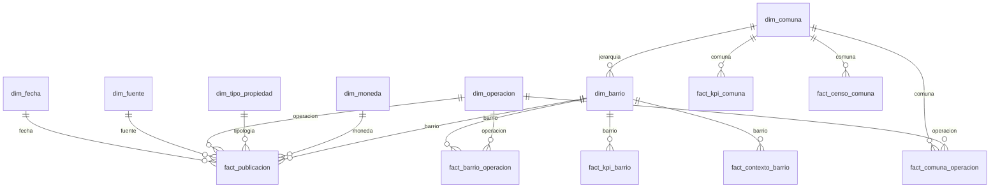

# Modelo dimensional para el dashboard PE3

El mart separa tablas de hechos por granularidad. No se unen hechos directamente: las dimensiones filtran cada hecho en relaciones 1:N con filtro unidireccional. La geografía usa una jerarquía normalizada `dim_comuna → dim_barrio`; los hechos barriales se conectan solo al barrio.

## Granularidad

| Tabla | Una fila representa |
|---|---|
| `fact_publicacion` | fuente × id × operación |
| `fact_barrio_operacion` | barrio × corte PE2 × operación |
| `fact_kpi_barrio` | barrio × corte PE2 |
| `fact_comuna_operacion` | comuna × corte PE2 × operación |
| `fact_kpi_comuna` | comuna × corte PE2, métricas de mercado |
| `fact_contexto_barrio` | barrio × versión de contexto |
| `fact_censo_comuna` | comuna × Censo 2022 |

## Medidas, relaciones y límites

- Conteos de anuncios miden oferta capturada, no stock de viviendas ni contratos.
- Precios son no aditivos: usar mediana/percentiles, segmentados por operación y moneda. No promediar o sumar publicaciones para inferir valor transaccional.
- Ratios y densidades se consumen en su grano; no promediar porcentajes ni repetir denominadores censales a nivel de publicación.
- Airbnb es un indicador de alquiler temporario y queda diferenciable de la oferta inmobiliaria tradicional según cobertura de las fuentes.
- El Censo y el tamaño medio del hogar se mantienen a nivel comuna; este último es un proxy indirecto para H2a.
- La fecha de extracción no crea una serie temporal de snapshots. No mostrar evolución temporal con un único corte.
- La dimensión barrio almacena `comuna_key`; KPIs y publicaciones barriales se filtran por comuna a través de la jerarquía comuna → barrio. Se evita una segunda FK comuna directa en el hecho de publicaciones para mantener una sola ruta de filtro.
- Las publicaciones sin barrio oficial asignado no participan de un filtro comunal desde `dim_barrio`; medir y mostrar esa cobertura antes de interpretar totales territoriales.
- Las dimensiones geográficas actuales reflejan este corte. Para comparar futuras cargas, usar códigos oficiales estables o versionar cambios de nombres/correspondencias.
- El constructor valida la clave fuente × id × operación y se detiene si encuentra duplicados, en vez de ocultarlos.
- Ejecución: `python src/build_dashboard_mart.py`. Produce CSV por tabla y `data_model.json` con granos, columnas y número de filas.

## Paquete de importación para Power BI

Al ejecutar `python src/build_dashboard_mart.py`, además de los CSV y `data_model.json`, se generan la carpeta `data/processed/dashboard_mart/powerbi/` y el archivo `data/processed/dashboard_mart_powerbi.zip`. El ZIP contiene las tablas y los metadatos de carga para compartir con el equipo.

- `relaciones.csv`: relaciones con cardinalidad 1:* y filtro unidireccional.
- `esquema_powerbi.json`: rol, filas, columnas y tipos sugeridos por tabla.
- `medidas_dax.dax`: medidas iniciales de conteo y acceso a KPIs no aditivos mediante `SELECTEDVALUE`.
- `fnLoadMartCsv.m`: función opcional de Power Query para cargar cada archivo desde una carpeta.
- `README.md`: pasos de importación y reglas de interpretación.

El generador produce un paquete de tablas y configuración; no crea un archivo `.pbix` con páginas visuales ni publica un modelo semántico. Tras importar, el equipo debe revisar tipos, crear las relaciones enumeradas y validar las medidas con filtros antes de diseñar el tablero. Las relaciones se generan según las columnas presentes, por lo que pueden variar ante cambios del esquema.
